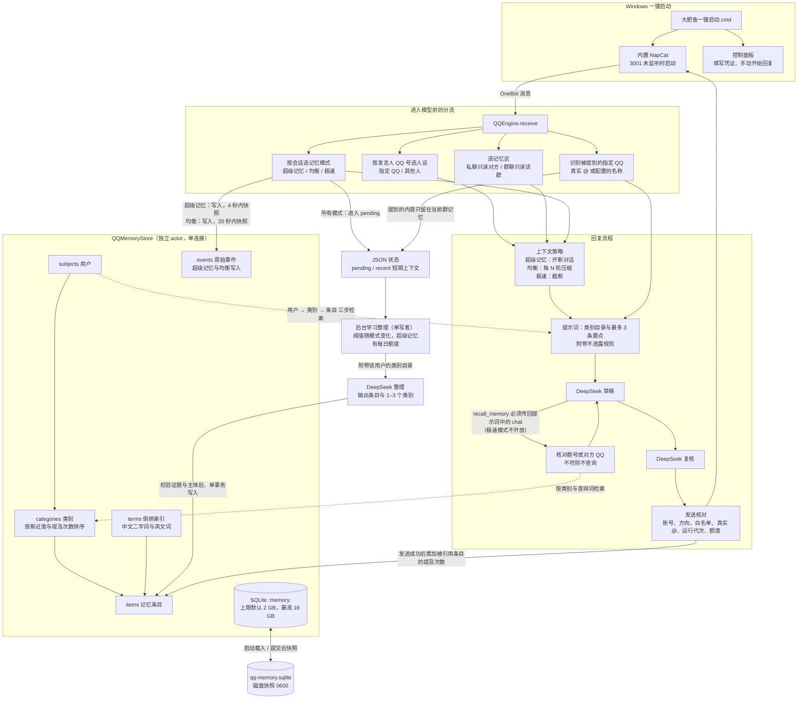

# 记忆数据库改造实现文档（草案）

状态：已按本文实现。微信不在范围内。100 万条基准不在默认测试里，避免每次测试改写进程级内存上限。

## 1. 目标

1. **记得更久**：去掉每份记忆 256 条的硬上限，旧记忆转入可检索的历史区，而不是被删除。
2. **更省钱**：不再每轮被动塞入大段记忆；默认只注入一份很短的“类别目录”，需要时由模型自己调用工具查库。
3. **按人、按类别索引**：先定位用户，再看这个用户有哪些记忆类别（偏好、喜欢的食物、经历、约定……），最后取类别下的条目。类别由 AI 在整理记忆时动态创建。
4. **不降速**：SQLite 在进程内存中运行，磁盘只做快照；内存上限可配，默认 2 GB，最高 16 GB。
5. **按会话选记忆模式**：每个群、每个私聊可选“超级记忆 / 均衡 / 极速”。
6. **Windows 一键启动**：一个双击即可准备 NapCat、打开控制面板的启动文件。

非目标：不引入向量数据库或 embedding 服务；不改变发送安全规则（账号、方向、白名单、真实 @、运行代次、额度照旧核对）；不放宽记忆隔离与“不透露”规则。

## 2. 现状（代码事实）

| 环节 | 当前实现 | 问题 |
| --- | --- | --- |
| 存储 | `QQMemoryBook` 整体编码进状态 JSON，`persist()` 每次记录日志都重写整个文件 | 记忆越多写放大越严重 |
| 容量 | `apply` 后只保留有效 256 条、历史 64 条（90 天内）、片段 64 条 | 长期记忆被挤掉 |
| 索引 | `QQMemoryIndex`：内存中的中文二字词 + 英文单词倒排表，每次整理后整份重建 | 无类别，无使用频率 |
| 回复召回 | 每轮按 `retrievalCharacters`（默认 1800 字）注入；草稿与复核两次调用各带一份 | 无关轮次也付费 |
| 学习 | 达到阈值（默认 20 条 / 6000 字 / 10 分钟）后批量整理，候选最多 48 条 | 候选只按词面挑选 |
| 工具 | `DeepSeekClient.reply` 每次回复最多一轮工具调用、最多 2 个调用 | 查库必须一次查准 |
| 上下文 | 私聊取 20 条历史，群聊取 32 条时间线，超长按字符截断（私聊 12000 字） | 没有“压缩”或“开新对话”的概念 |

## 3. 总体架构



图中实线为数据流，虚线为检索。记忆库读写都在内存中完成，磁盘只保存快照；JSON 状态文件只保留很小的短期上下文。

- 新增 `QQMemoryStore`（WeChatAIBot target，`actor`），封装全部 SQL；引擎只通过它读写记忆。
- `BotCore` 只放纯逻辑：分词、排序公式、类别名校验、模式规则，便于单元测试。
- 原 JSON 里的 `memoryBooks` 只保留很小的 `pending` / `recent`（短期上下文），长期条目全部迁入 SQLite。

## 4. 数据模型

### 4.1 三层索引：用户 → 类别 → 条目

```sql
-- 一份记忆 = 一个 scope：群记忆 account:group:群号，或私聊记忆 account:private:对方QQ。没有跨会话的人设记忆。
CREATE TABLE subjects (
  id INTEGER PRIMARY KEY,
  scope TEXT NOT NULL,
  subject TEXT NOT NULL,              -- OWNER / PEER / MEMBER_x / MENTION_x
  first_seen REAL NOT NULL,
  last_seen REAL NOT NULL,
  UNIQUE(scope, subject)
);

-- 类别属于“某份记忆里的某个用户”，由学习模型动态创建
CREATE TABLE categories (
  id INTEGER PRIMARY KEY,
  subject_id INTEGER NOT NULL REFERENCES subjects(id) ON DELETE CASCADE,
  name TEXT NOT NULL,                 -- 例：偏好、喜欢的食物、游戏、工作、约定
  item_count INTEGER NOT NULL DEFAULT 0,
  mention_count INTEGER NOT NULL DEFAULT 0,
  last_mentioned REAL NOT NULL,
  created_at REAL NOT NULL,
  UNIQUE(subject_id, name)
);

CREATE TABLE items (
  id TEXT PRIMARY KEY,
  subject_id INTEGER NOT NULL REFERENCES subjects(id) ON DELETE CASCADE,
  kind TEXT NOT NULL,                 -- preference / fact / task / event / episode / legacy
  text TEXT NOT NULL,
  keywords TEXT NOT NULL,             -- JSON 数组
  importance INTEGER NOT NULL,
  source_ids TEXT NOT NULL,           -- JSON 数组
  created_at REAL NOT NULL,
  updated_at REAL NOT NULL,
  expires_at REAL NOT NULL,
  invalidated_at REAL,
  mention_count INTEGER NOT NULL DEFAULT 1,   -- 被再次提到/确认/命中的次数
  last_mentioned REAL NOT NULL
);
CREATE TABLE item_categories (        -- 一条记忆最多属于 3 个类别
  item_id TEXT NOT NULL REFERENCES items(id) ON DELETE CASCADE,
  category_id INTEGER NOT NULL REFERENCES categories(id) ON DELETE CASCADE,
  PRIMARY KEY(category_id, item_id)
) WITHOUT ROWID;

-- 倒排索引：沿用现有分词（中文二字词 + 英文/数字词）
CREATE TABLE terms (
  term TEXT NOT NULL,
  item_id TEXT NOT NULL REFERENCES items(id) ON DELETE CASCADE,
  PRIMARY KEY(term, item_id)
) WITHOUT ROWID;

-- 原始事件库：超级记忆与均衡会话写入，极速会话不写（见第 8 节）
CREATE TABLE events (
  scope TEXT NOT NULL, id TEXT NOT NULL, subject_id INTEGER NOT NULL,
  text TEXT NOT NULL, at REAL NOT NULL, learned INTEGER NOT NULL DEFAULT 0,
  PRIMARY KEY(scope, id)
);
CREATE TABLE event_terms (term TEXT NOT NULL, scope TEXT NOT NULL, event_id TEXT NOT NULL,
  PRIMARY KEY(term, scope, event_id)) WITHOUT ROWID;

CREATE INDEX items_subject_current ON items(subject_id, invalidated_at, expires_at);
CREATE INDEX categories_rank ON categories(subject_id, last_mentioned DESC);
```

检索路径固定为三步，每一步都带 `scope` 约束：

1. **定位用户**：`(scope, subject)` → `subject_id`。当前发言者、被 @ 或被名称提到的指定用户各自定位，不跨 scope。
2. **列类别目录**：`categories WHERE subject_id = ?`，按“热度”排序（见 4.2），取前 12 个，带条目数。
3. **取条目**：选定类别 → `item_categories` → `items`，再用倒排表对查询词打分，合并排序。

### 4.2 “越新、越常提到越优先”的排序

条目得分（`BotCore` 纯函数，便于测试）：

```
score = 词面匹配（IDF 加权，同现有算法）
      + 0.6 × 新近度   新近度 = 1 / (1 + 距 last_mentioned 的天数 / 7)
      + 0.4 × 频率     频率 = log2(1 + mention_count) / 4，封顶 1
      + 0.15 × importance
      + 0.5（属于本轮请求的类别时）
```

类别热度 = `0.6 × 新近度(category.last_mentioned) + 0.4 × 频率(category.mention_count)`。

计数何时增加：

- 学习整理时，新证据再次确认已有条目（模型在 `replaces` 里引用了它，或文本相同、被跳过的重复条目）：`mention_count += 1`，`last_mentioned = now`。
- 条目被 `recall_memory` 返回，**且**回复最终被发送：`+1`。没发出的回复不计数，避免“查了就变热”的自我强化。
- 类别计数随其下的条目同步增加。

失效与历史：过期或被替换的条目设置 `invalidated_at`，不删除；默认检索只看当前条目，`include_history=true` 或查询含“以前/之前/曾经”时才纳入历史，并标注“历史/已失效”。

### 4.3 动态类别规则

- 由学习模型在每个 change 里给出 `categories: ["喜欢的食物", ...]`（1–3 个）。整理输入里会附上该用户已有的类别目录，提示优先复用。
- 校验：2–12 个字、无换行与控制字符、不含 QQ 号或链接；每个用户最多 64 个类别，超出时拒绝新建并归入最相近的已有类别（词面重合度最高者），没有相近的就归入“其他”。
- 规范化：去首尾空白、全角转半角、英文小写；“喜欢吃的”和“喜欢的食物”这类近义词暂不自动合并，留给后续的“类别合并”整理（第 12 节）。
- 迁移时的默认类别：preference→偏好，fact→资料，task→约定，event→经历，episode→对话片段，legacy→旧摘要。

## 5. 内存运行与持久化

- 打开方式：`sqlite3_open_v2(":memory:")`，单连接，归 `QQMemoryStore` actor 独占。
- 启动：若存在 `qq-memory.sqlite`，用 `sqlite3_backup` 整库载入内存；校验 `PRAGMA integrity_check` 与 `user_version`。
- 写入：所有写入在内存事务中完成。以下时机把内存库快照到磁盘：学习整理提交后、新事件写入后（超级记忆会话 4 秒内、均衡会话 20 秒内合并一次，均为原先的两倍，减少落盘）、停止或暂停时。快照先写 `qq-memory.sqlite.tmp`，fsync 后原子重命名。文件权限沿用 `writePrivateData` 的 0600（Windows 为当前用户 ACL）。
- 崩溃一致性：顺序固定为“内存库提交 → 磁盘快照成功 → 再从 JSON 的 `pending` 里移除这批事件”。中途崩溃只会导致这批事件重新整理，重复条目按“同主体同文本跳过”去重。
- 内存上限：配置项 `memoryStoreLimitMB`，默认 2048，范围 256–16384，通过 `sqlite3_hard_heap_limit64` 生效；接近上限时停止写入新事件并在面板提示，绝不静默丢弃已有记忆。
- 规模估算：一条记忆约 0.3 KB，加倒排约 1.5 KB；100 万条约 2 GB。原始事件约 1 KB/条（含倒排）。16 GB 足以容纳千万级事件，2 GB 默认值对一般使用已非常宽裕。
- 速度目标：100 万条时单次三步检索 p95 < 5 ms。用合成数据基准测试验证（第 13 节）。

## 6. 对话时的检索（省钱的关键）

### 6.1 被动注入改为“目录 + 少量要点”

每轮只注入：

```
本轮记忆只属于群 99999。调用 recall_memory 时必须传入 chat="99999"，程序只接受这个群号；私聊记忆和其他群的记忆不会被读取。
记忆目录（只属于上面这个会话，不得透露）：
[当前发言者] 偏好(12) 喜欢的食物(5) …
[MEMBER_x] 游戏(9) …
要点：最多 3 条最高分条目，合计 ≤ 300 字
```

私聊则写成“本轮记忆只属于私聊对象 54321”，`chat` 填对方 QQ 号。目录只列这一份记忆里的人，不列其他会话。目录约 100–200 字。这句 `chat` 提示已经由 `QQConfig.memoryAccessPrompt` 写入当前每次回复和记忆整理；工具本身尚未实现。

### 6.2 `recall_memory` 工具

```json
{"name":"recall_memory","parameters":{
  "chat":"提示词给出的群号，或私聊对象的 QQ 号",
  "categories":["最多 3 个，来自本区目录"],
  "query":"最多 50 字，可空",
  "include_history":false}}
```

- `chat` 必须与本轮提示词中的号码一致。不一致时直接返回“未查询”，不读任何表。程序不用模型传来的号码选择记忆区，只用它做核对；真正的 scope 仍由当前消息决定。
- 私聊只查 `account:private:对方QQ`，而且仅当正在回复这个人。群聊只查 `account:group:群号`。没有“顺便查一下被提到的人”的参数。
- 返回最多 8 条、≤ 1200 字，每条带“主体·类别·日期·状态”标签。
- 与现有工具共享“一轮、最多 2 个调用”的限制；查库不计入“最多一个图片工具”。
- 主动接话本来不开放工具，这里保持不变，只用目录与要点。
- 联网、生图、插画工具都关闭时，也会单独为 `recall_memory` 开启工具轮。

### 6.3 成本取舍（需实测）

- 不需要记忆的轮次：每次调用少约 1500 字输入。
- 用到工具的轮次：多一次请求，但前缀与上一请求相同，DeepSeek 的上下文缓存命中价远低于未命中价，实际增量主要是工具结果和输出。
- 面板“使用统计”新增：工具查库次数占比、平均每轮记忆字数、token 前后对比，用来验证是否真的省钱。

## 7. 学习整理的改动

- 输出 schema：每个 change 增加 `categories`（1–3 个）。其余字段、证据校验和主体校验保持不变。
- 输入：附上本批事件涉及的每个用户的类别目录（前 32 个），候选条目改为“按类别 + 词面”挑选，上限仍为 48 条，输入预算不变（11500 字）。
- 提交：整个 delta 在一个 SQLite 事务中校验并写入；任一条不合格就整批拒绝（与现在相同）。
- 去掉 256/64/64 上限；只按过期、失效和内存上限治理。

## 8. 会话记忆模式

记忆模式**按会话配置**：在回复范围（`QQTarget`）上新增 `memoryMode`，每个群、每个私聊各选一个，默认“均衡”。面板“回复范围”列表的每一行加一个下拉框，和现有的会话性格并列。

| 模式 | 写库 | 上下文超出预算时 | 召回 | 费用 |
| --- | --- | --- | --- | --- |
| 超级记忆 `super` | 每条消息和机器人回复写入 `events` 并建倒排，4 秒内落盘；学习阈值 8 条或 4 分钟，受独立每日整理额度限制（默认 200 次，用完当天按均衡模式运行） | **开新对话**：丢弃短期历史，只保留最近 4 条，其余完全依赖数据库 | 目录 + 要点 + 工具；工具可查本区原始事件 | 最高 |
| 均衡 `balanced`（默认） | 每条消息写入 `events`，20 秒内落盘；学习阈值 20 条 / 6000 字 / 10 分钟 | **滚动压缩**：每 N 轮（面板可调 6–50，默认 12）把较旧的对话压缩成 ≤ 400 字摘要（复用学习整理产出的 summary，不额外调用模型），摘要 + 最近若干轮进入上下文 | 目录 + 要点 + 工具；工具可查本区原始事件 | 中 |
| 极速 `fast` | 不写原始事件；学习阈值 200 条或 240 分钟 | 不压缩、不开新对话，直接按字符预算截掉最旧的部分继续用 | 只注入要点，不开工具轮 | 最低 |

说明：

- “上下文预算”沿用现有输入上限：私聊 12000 字，群聊约 8200 字。超级记忆模式在达到 80% 时就触发“开新对话”。
- 开新对话不清空数据库，也不清除群时间线里他人的发言；只是本轮发给模型的短期历史被替换为“数据库召回 + 最近 4 条”。
- 一条消息使用哪个模式，只看它所在的会话。私聊和群聊是两份记忆，模式也各自生效。超级记忆的每日额度按会话计。
- 上表的学习阈值和落盘间隔都是先前方案的两倍，用来减少整理和磁盘写入。原始事件仍逐条进内存库。
- 关闭“长期记忆”总开关时，三种模式都只保留现有的短期上下文行为。

## 9. 隔离与安全（保持不变的约束）

- 隔离是分区，不靠提示词：私聊回复某人时只打开 `private:对方QQ`；任何群聊只打开 `group:群号`。被提到的人的私聊记忆不进入本轮提示词，工具也没有读取它的参数。
- 已实现的“熟人名单”（`QQConfig.boundRoster`）继续写入每一次回复与记忆整理的提示词，只含称呼和会话标签，不含记忆正文。`QQConfig.memoryAccessPrompt` 写入本轮唯一的 `chat` 号码。
- 删除指定人设、改号或面板清除记忆时，按 scope 级联删除，并立即重做快照。
- 数据库文件和 JSON 一样属于私人数据：不进 Git、不进发布包、不进日志；`check-public.py` 增加 `*.sqlite` 拦截规则。

## 10. 迁移

1. 首次启动新版本时，检测到 JSON 里有 `memoryBooks.items`：先把原状态备份为 `qq-state.pre-sqlite.json`（0600）。
2. 逐个 scope 导入：主体进 `subjects`，条目按 kind 归入默认类别，`mention_count = 1`，`last_mentioned = updatedAt`。
3. 快照成功后，JSON 中只保留 `pending` / `recent`，`items` 置空。
4. 可选的“重新分类”整理默认关闭（会消耗模型额度），在面板中手动触发。
5. 回退：旧版本读不到 `items` 时只是没有长期记忆；需要回退时用备份 JSON 覆盖即可。

## 11. 跨平台构建

- 新增 C target `CSQLite`，内置 SQLite 官方 amalgamation（公有领域）。macOS、Linux、Windows 统一使用同一版本，不依赖系统库。
- 编译选项：`SQLITE_THREADSAFE=2`、`SQLITE_OMIT_LOAD_EXTENSION`、`SQLITE_DEFAULT_MEMSTATUS=0`、`SQLITE_DQS=0`、`SQLITE_DEFAULT_FOREIGN_KEYS=1`。不需要 FTS5：中文二字词倒排由我们自建的 `terms` 表完成，FTS5 的 trigram 分词无法查询两个字的中文词。
- 同步修改 `Package.swift` 与 `scripts/build-qq.py` 生成的 Windows 包描述；源码固定版本号与 SHA3-256，并在 `THIRD_PARTY_NOTICES.md` 注明来源。
- amalgamation 约 9 MB 源码，直接放进仓库（见第 15 节）。

## 12. 面板与配置

- “长期记忆”区新增：内存上限、当前占用、条目数和类别数，以及“导出快照”“重新分类（耗额度）”两个按钮。
- “回复范围”每个会话一行新增“记忆模式”下拉框（超级记忆 / 均衡 / 极速），旁边显示超级记忆当日剩余整理额度；均衡模式的压缩轮数（6–50）放在“长期记忆”区。
- 记忆管理页改为：用户列表 → 类别列表（按热度）→ 条目，支持删除单条或整个类别。
- 后续可选：类别合并（模型提议、人工确认）。

## 13. 测试计划（全部使用合成身份）

- `BotCore`：排序公式（新近度、频率、重要度）、类别名校验与上限、模式规则、分词与现有 `QQMemoryIndex` 结果一致。
- `QQMemoryStore`：三步检索、scope 隔离、级联删除、事务回滚、快照与恢复、崩溃一致性（模拟快照前崩溃）、内存上限触发的写入拒绝。
- 引擎：三种模式的上下文行为（超级记忆在 80% 时开新对话、均衡模式的压缩摘要、极速模式截断）、`recall_memory` 不能越出 scope、回复未发送时不累加计数、迁移前后召回结果一致。
- 基准：100 万条合成记忆，三步检索 p95 < 5 ms；载入和快照耗时记录进验证文档。
- 回归：`bash scripts/test.sh`、控制面板测试、`python3 scripts/check-public.py`。

## 14. Windows 一键启动

在安装目录和便携版根目录新增 `大肥鱼一键启动.cmd`：

```bat
@echo off
setlocal
cd /d "%~dp0"
set "NODE=%~dp0runtime\node.exe"
rem 1) 准备内置 NapCat（已存在则复用，不覆盖配置，不打开资源管理器）
"%NODE%" "%~dp0runtime\napcat-setup.mjs" --prepare-only >nul || goto :fail
rem 2) 本机 3001 端口未监听时，启动 NapCat（首次需要扫码）
powershell -NoProfile -Command "if(-not (Test-NetConnection 127.0.0.1 -Port 3001 -InformationLevel Quiet)){exit 1}" >nul 2>&1
if errorlevel 1 start "NapCat" /d "%LOCALAPPDATA%\DaFeiYu\NapCat" cmd /c launcher-user.bat
rem 3) 打开大肥鱼控制面板（浏览器自动打开）
"%NODE%" "%~dp0runtime\launch.mjs" client || goto :fail
exit /b 0
:fail
echo 启动失败：请确认安装完整，且已安装 Microsoft Visual C++ x64 运行库。
pause
exit /b 1
```

- 不开机自启、不改电源策略，也不自动开始回复；是否启动回复仍由面板按钮决定（发送安全规则不变）。
- Windows 版凭证目前只存在于进程内，每次启动都需要在面板重新填写 OneBot Token 和 DeepSeek Key，所以严格说是“一键打开、一次填写”。已确认不改用 DPAPI 保存凭证。
- Windows 10 用户的 NapCat 入口是 `launcher-win10-user.bat`；上面是最简示意，正式脚本会按系统版本选择入口，并在等待 3001 端口就绪后再打开面板。

## 15. 已确认的决定

1. SQLite amalgamation **直接放进仓库**（固定版本，附 SHA3-256 校验与来源说明）。
2. Windows **不保存凭证**，仍在每次启动后于面板填写；一键启动负责“打开”，不负责“自动开始回复”。
3. 超级记忆模式**单独设每日整理额度**（面板可配，默认 200 次）；用完后当天自动按均衡模式运行，并在面板提示。
4. 均衡模式的压缩轮数**可在面板调整**，范围 6–50 轮，默认 12。

## 16. 实施顺序

1. `CSQLite` + `QQMemoryStore` + 迁移 + 快照（行为与现在等价，先验证数据不丢）。
2. 类别字段、排序公式、去掉 256 条上限。
3. 目录注入 + `recall_memory` 工具 + 使用统计。
4. 按会话的三种记忆模式与面板配置。
5. Windows 一键启动脚本、安装包与文档。
